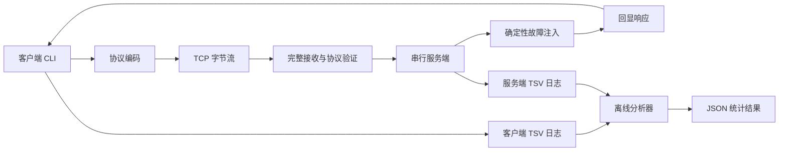

# 架构与设计取舍

## 数据路径

客户端一条请求使用一个 TCP 连接。事务开始时记录 `sent`，生成绝对截止时间，连接、发送和完整响应接收共用这个截止时间。任何阶段超时都关闭连接并写入终态；不会重试或者从错误帧中猜测新的帧边界。

服务端在单线程中串行接受连接，对每个连接循环读取帧。先读取 24 字节头并验证类型、版本、保留位及长度上限，再分配负载缓冲区，读完后验证校验和。接收到有效 request 后进行故障判断，否则发送相同 ID、相同负载的 response。

`receive_message` 使用精确读取循环：一次 `recv` 返回的字节数不代表消息边界。一次接收不足继续读，多条消息同时抵达时每次只取当前帧所需字节，后续字节留在内核缓冲区。独立的 `FrameDecoder` 还提供面向任意碎片输入的增量解析接口，缓冲区最多存一条合法大小的帧。

## 生命周期与错误处理

- `Socket` 不可复制、可移动，析构自动关闭，异常路径同样回收。
- Windows 使用 Winsock 初始化及非阻塞 `ioctlsocket`；Linux 使用 `fcntl(O_NONBLOCK)`。
- `select` 在每次等待前重新计算剩余时间，慢速字节流不会延长单帧截止时间。
- Windows 连接失败可能通过 exception fd set 报告；等待后用 `SO_ERROR` 判断连接结果。
- Linux 写入使用 `MSG_NOSIGNAL`，避免对端关闭时 `SIGPIPE` 终止进程。
- 无效头在负载分配前被拒绝；不支持出错后扫描 magic 重同步。
- EOF 记录 `disconnected`，其他系统错误记录 `io_error`，错误文本附带系统 Socket 错误码。
- 日志打开或刷新失败为运行错误，避免无声丢失诊断证据。

## 确定性故障

每接受一条有效 request，服务端递增全局计数，满足 `序号 % fault_every == 0` 时注入指定故障。模式互斥，不采用随机概率，因此可稳定复现同一请求序列。

| 模式 | 实现 | 可观测结果 |
|---|---|---|
| delay | 解码后 sleep 指定毫秒数 | 客户端耗时上升或超时 |
| drop | 不发送当前 request 的响应 | 客户端等待到截止时间，或服务端先关闭 |
| corrupt | 翻转响应校验和的一位 | 客户端拒绝 response |
| disconnect | 收到 request 后主动关闭 | 客户端收到 EOF 或系统重置错误 |

`drop` 未调用网络层丢包工具，不改变 TCP 的可靠传输语义。`corrupt` 修改的是应用层生成的字节，TCP 仍正常传输这些字节。

## 有意保留的简单设计

串行服务端便于理解 Socket 和协议边界，无法提供高并发或公平调度；一个连接在其超时内会阻塞后续连接。客户端每次重连带来额外开销，但隔离失败事务，简化迟到响应处理。因此当前延迟指标是完整事务耗时，不宣传为纯网络 RTT 或生产吞吐性能。

每个进程生成随机 session，在该 session 内分配消息 ID。它用于离线日志关联，不是网络认证信息；服务端和客户端的 session 不相同，不以 session 跨角色关联单条请求。需要多客户端端到端追踪时，可在下一版本把 trace ID 纳入协议。
